<p align="center">
  
</p>

<p align="center">
  <a href="https://github.com/ishandutta2007/Awesome-Awesome-Awesome"></a>
  <a href="https://discord.gg/jc4xtF58Ve"></a>
  <a href="https://github.com/ishandutta2007/Awesome-Web-Animation-Libraries/stargazers"></a>
  <a href="https://github.com/ishandutta2007/Awesome-Web-Animation-Libraries/network/members"></a>
  <a href="https://github.com/ishandutta2007/Awesome-Web-Animation-Libraries/pulls"></a>
  <a href="https://github.com/ishandutta2007/Awesome-Web-Animation-Libraries/blob/main/LICENSE"></a>
  <a href="https://github.com/ishandutta2007"></a>
</p>

---

# 🌟 Awesome Web Animation Libraries

> **A definitive, SEO-optimized directory of production-grade Web Animation Libraries, JavaScript motion engines, CSS animation toolkits, SVG morphing engines, physics springs, and cloud animation SaaS platforms.**

Whether you are crafting interactive storytelling experiences, 60+ FPS UI transitions, spring physics micro-interactions, programmatic video rendering, or designer-exported Lottie/Rive animations, this curated index brings together the top open-source repositories and enterprise platforms across the modern web ecosystem.

---

## 📑 Table of Contents

- [🎯 Quick Decision Matrix](#-quick-decision-matrix)
- [🏢 SaaS & Cloud Motion Platforms](#-saas--cloud-motion-platforms)
  - [📊 Sector Overview & Market Dynamics](#-sector-overview--market-dynamics)
  - [🏷️ SaaS Platforms Comparison](#️-saas-platforms-comparison)
- [🐙 Open-Source GitHub Projects](#-open-source-github-projects)
  - [🏆 Top Open-Source Libraries (Ranked by Stars)](#-top-open-source-libraries-ranked-by-stars)
  - [🧩 Libraries by Functional Specialty](#-libraries-by-functional-specialty)
- [💡 Architectural Best Practices](#-architectural-best-practices)
- [🤝 How to Contribute](#-how-to-contribute)
- [💖 Support & Community](#-support--community)
- [📈 Star History](#-star-history)
- [📜 License & Disclaimer](#-license--disclaimer)

---

## 🎯 Quick Decision Matrix

| Use Case | Recommended Solution | Primary Benefit |
| :--- | :--- | :--- |
| **React / Next.js UI Motion** | [Motion](https://github.com/motiondivision/motion) | Declarative layout animations, exit animations, gestures & WAAPI |
| **Vanilla JS Timelines & SVG** | [Anime.js](https://github.com/juliangarnier/anime) | Micro-footprint, staggered timings, complex SVG transforms |
| **Commercial Complex Timelines** | [GSAP](https://gsap.com/) | Battle-tested scroll-triggering, morphing, high browser compatibility |
| **Physics & Natural Springs** | [React Spring](https://github.com/pmndrs/react-spring) | Organic fluid physics, seamless React Three Fiber 3D hooks |
| **Designer Hand-off & JSON** | [Lottie](https://github.com/airbnb/lottie-web) / [Rive](https://rive.app/) | After Effects / Rive Editor exports with tiny asset payloads |
| **Instant Zero-Config Lists** | [Auto-Animate](https://github.com/formkit/auto-animate) | Single-line automatic DOM transition animations |
| **Programmatic Video via React** | [Remotion](https://github.com/remotion-dev/remotion) | Code-driven MP4/WebM video generation and timeline sequencing |
| **CSS-Only Quick Effects** | [Animate.css](https://github.com/animate-css/animate.css) | Class-name driven `@keyframes` without JavaScript overhead |

---

## 🏢 SaaS & Cloud Motion Platforms

### 📊 Sector Overview & Market Dynamics

The global web animation and motion design software market is currently valued between **$38.5 Billion and $42.8 Billion**, with the specialized web UI motion, interactive vector animation, and digital asset rendering sub-segment accounting for over **$2.5 Billion** and expanding at an ~11.8% CAGR. 

The sector exhibits **moderate fragmentation**: while design giants and visual website builders such as Adobe and Webflow maintain extensive ecosystem footprint, specialized high-performance runtime formats and state-machine engines (such as LottieFiles and Rive) possess strong format defensibility. As a result, the market avoids a single "winner-take-all" monopoly, enabling agile SaaS platforms and developer-focused API tools to thrive alongside open runtimes.

---

### 🏷️ SaaS Platforms Comparison

The following table summarizes notable commercial SaaS products in the web motion, vector animation, and interactive graphics landscape. Products are sorted in **descending order by company valuation / revenue scale**.

| Platform | Company Size (Valuation / Revenue) | Starting Pricing | Free Tier / Trial Limits | Core Focus & Key Capabilities |
| :--- | :--- | :--- | :--- | :--- |
| **[Webflow (GSAP)](https://webflow.com/)** | **~$4.0 Billion Valuation** (~$150M+ ARR) | **$14/month** *(Basic plan billed annually; GSAP core runtime is free for standard web; commercial redistribution license is $150/year)* | **Free Forever Plan**: 2 unhosted projects, webflow.io staging domain, 50 CMS items, full GSAP client-side animation capabilities | Enterprise visual development platform with native support for the industry-standard GSAP timeline engine and responsive scroll animations. |
| **[LottieFiles](https://lottiefiles.com/)** | **~$150 Million Valuation** (~$39.6M ARR, $47M raised) | **$19.99/user/month** *(Individual plan billed annually)* | **Free Forever Plan**: 10 lifetime private file uploads, 5 public animation downloads per workspace, unlimited public community uploads | End-to-end Lottie ecosystem offering web-based motion editing, Figma/After Effects plugins, team collaboration, and global asset CDN hosting. |
| **[Linearity (Linearity Move)](https://www.linearity.io/)** | **~$110 Million Valuation** (~$33M+ total raised) | **$9.99/month** *(Pro plan billed annually)* | **Free Forever Plan**: 3 active workspace files, up to 10-second animation exports, 720p export with Linearity watermark | Modern vector graphics and motion suite that converts static vector illustrations into animated UI banners and video assets with AI-assisted tweening. |
| **[Spline](https://spline.design/)** | **~$80 Million Valuation** (~$4.7M ARR, $32.4M raised) | **$12/month** *(Pro plan billed monthly, or $9/mo billed annually)* | **Free Forever Plan**: Unlimited personal files, 2,000 monthly AI credits, interactive 3D web exports with Spline watermark branding | Collaborative browser-based 3D design and animation platform enabling real-time physics, camera transitions, and embeddable interactive web canvas scenes. |
| **[Rive](https://rive.app/)** | **~$60 Million Valuation** (~$14M raised, a16z backed) | **$9/seat/month** *(Cadet plan billed annually, or $17/mo monthly)* | **Free Forever Plan**: 3 collaborative files, 1 project, unlimited personal editor files; runtime `.riv` production export requires paid plan | State-machine interactive graphics platform delivering high-performance 120 FPS runtime animations for web, games, and cross-platform apps with zero CPU bloat. |
| **[Jitter](https://jitter.video/)** | **~$8 Million Valuation** (~$1.5M ARR, Y Combinator backed) | **$15/editor/month** *(Pro plan billed annually, or $19/mo monthly)* | **Free Forever Plan**: 3 active workspace files, 720p at 30fps exports with Jitter watermark, limited baseline AI prompt credits | Fast, collaborative UI motion design tool tailored for product teams, micro-interactions, app previews, and social media video export. |
| **[SVGator](https://www.svgator.com/)** | **~$4 Million Valuation** (~$1.1M ARR, Bootstrapped) | **$13/month** *(Starter plan billed annually, or $18/mo monthly)* | **Free Forever Plan**: Unlimited static SVG exports, access to keyframe timeline editor; animated exports (SVG, Lottie, GIF) require paid plan | Dedicated no-code keyframe animator for pure SVG vectors, path morphing, clipping paths, stroke animations, and interactive trigger generation. |
| **[Bannerbear](https://www.bannerbear.com/)** | **~$2.5 Million Valuation** (~$750k ARR, Bootstrapped) | **$49/month** *(Automate plan with 1,000 API credits/month)* | **Free Trial Only**: 30 lifetime API credits, non-renewable, hard stop at 100% usage (no credit card required) | Developer API for programmatic image, animated GIF, and dynamic video generation from structured JSON templates and motion layers. |

---

## 🐙 Open-Source GitHub Projects

### 🏆 Top Open-Source Libraries (Ranked by Stars)

Below are the most popular open-source web animation repositories, ranked strictly in **descending order by GitHub stargazer count**. Every badge links directly to that repository's stargazers page:

1. **[Animate.css](https://github.com/animate-css/animate.css)** [](https://github.com/animate-css/animate.css/stargazers)  
   *🍿 Cross-browser library of ready-to-use CSS animations. Ideal for landing page entrances, attention seekers, and lightweight UI elements without writing JavaScript.*

2. **[Anime.js](https://github.com/juliangarnier/anime)** [](https://github.com/juliangarnier/anime/stargazers)  
   *⚡ High-performance, lightweight JavaScript animation engine. Powers smooth CSS transforms, SVG path morphing, DOM attributes, and JS objects with chained timelines.*

3. **[Remotion](https://github.com/remotion-dev/remotion)** [](https://github.com/remotion-dev/remotion/stargazers)  
   *🎥 Programmatic video creation framework for React. Write animations using pure React components and render them directly to MP4/WebM videos.*

4. **[Motion (formerly Framer Motion)](https://github.com/motiondivision/motion)** [](https://github.com/motiondivision/motion/stargazers)  
   *🚀 Production-grade animation library for React and vanilla JavaScript. Features declarative syntax, spring physics, layout morphing, gestures, and hybrid WAAPI execution.*

5. **[Lottie Web](https://github.com/airbnb/lottie-web)** [](https://github.com/airbnb/lottie-web/stargazers)  
   *🎨 The industry-standard runtime for rendering Adobe After Effects vector animations natively on the web via JSON exports (Bodymovin).*

6. **[Particles.js](https://github.com/VincentGarreau/particles.js)** [](https://github.com/VincentGarreau/particles.js/stargazers)  
   *✨ Lightweight JavaScript library for creating interactive, floating particle systems, constellation networks, and ambient background animations.*

7. **[GSAP (GreenSock Animation Platform)](https://github.com/greensock/GSAP)** [](https://github.com/greensock/GSAP/stargazers)  
   *🥇 Ultra-performant, professional-grade JavaScript timeline animation framework. Features legendary plugins including ScrollTrigger, MorphSVG, and SplitText.*

8. **[React Spring](https://github.com/pmndrs/react-spring)** [](https://github.com/pmndrs/react-spring/stargazers)  
   *✌️ Modern spring-physics animation library for React applications. Bridges the gap between declarative components and organic physical movements.*

9. **[AOS (Animate On Scroll)](https://github.com/michalsnik/aos)** [](https://github.com/michalsnik/aos/stargazers)  
   *📜 CSS-driven animate-on-scroll library. Triggers smooth entry transitions as elements enter the browser viewport without heavy runtime dependencies.*

10. **[Popmotion](https://github.com/Popmotion/popmotion)** [](https://github.com/Popmotion/popmotion/stargazers)  
    *🎯 Low-level functional JavaScript animation library. Provides the underlying spring, keyframe, decay, and inertia physics primitives powering modern UI engines.*

11. **[Mo.js](https://github.com/mojs/mojs)** [](https://github.com/mojs/mojs/stargazers)  
    *🔮 Declarative motion graphics toolbelt for the web. Craft bursts, shape transforms, curved paths, and kinetic UI micro-effects effortlessly.*

12. **[Typed.js](https://github.com/mattboldt/typed.js)** [](https://github.com/mattboldt/typed.js/stargazers)  
    *⌨️ A JavaScript library that simulates real-time typing, backspacing, and character pausing animations with configurable cursor styles.*

13. **[Vivus](https://github.com/maxwellito/vivus)** [](https://github.com/maxwellito/vivus/stargazers)  
    *✒️ Lightweight zero-dependency JavaScript class that dynamically animates SVGs, giving them the visual appearance of being drawn in real time.*

14. **[Auto-Animate](https://github.com/formkit/auto-animate)** [](https://github.com/formkit/auto-animate/stargazers)  
    *✨ A zero-config, single-line drop-in animation utility that automatically adds smooth transitions to list reordering, insertions, and DOM layout changes.*

15. **[Barba.js](https://github.com/barbajs/barba)** [](https://github.com/barbajs/barba/stargazers)  
    *🌊 Fluid and seamless page transition manager. Transforms standard multi-page websites into slick Single Page Application (SPA) experiences with custom exit/entry hooks.*

16. **[Theatre.js](https://github.com/theatre-js/theatre)** [](https://github.com/theatre-js/theatre/stargazers)  
    *🎬 Visual motion design editor and animation framework for the web. Enables visual timeline choreographing for Three.js, React Three Fiber, SVG, and HTML DOM.*

17. **[Tween.js](https://github.com/tweenjs/tween.js)** [](https://github.com/tweenjs/tween.js/stargazers)  
    *⏱️ Simple, highly flexible JavaScript/TypeScript tweening engine. Optimized for numeric interpolations in Canvas 2D and Three.js 3D rendering loops.*

18. **[Locomotive Scroll](https://github.com/locomotivemtl/locomotive-scroll)** [](https://github.com/locomotivemtl/locomotive-scroll/stargazers)  
    *🛤️ Smooth scrolling library with built-in element viewport detection, parallax calculation, and customizable momentum physics.*

19. **[ProgressBar.js](https://github.com/kimmobrunfeldt/progressbar.js)** [](https://github.com/kimmobrunfeldt/progressbar.js/stargazers)  
    *📊 Responsive, slick SVG progress bars featuring animated line, circle, and semi-circle paths with built-in easing and step callbacks.*

20. **[ScrollTrigger](https://github.com/terwanerik/ScrollTrigger)** [](https://github.com/terwanerik/ScrollTrigger/stargazers)  
    *👁️ Open-source vanilla scroll trigger utility. Adds classes and executes animations based on element scroll positions using `requestAnimationFrame`.*

21. **[Panzoom](https://github.com/timmywil/panzoom)** [](https://github.com/timmywil/panzoom/stargazers)  
    *🔍 Extensible library for panning and zooming DOM elements using hardware-accelerated CSS transforms and touch gesture handling.*

22. **[Rive React](https://github.com/rive-app/rive-react)** [](https://github.com/rive-app/rive-react/stargazers)  
    *🎮 Official React runtime wrapper for Rive. Embeds lightweight, interactive vector graphics driven by state machines and trigger inputs.*

---

### 🧩 Libraries by Functional Specialty

#### ⚛️ Framework & UI Motion (React, Vue, Svelte)
- **[Motion](https://github.com/motiondivision/motion)** — Standard for React UI, spring gestures, and automatic layout transitions.
- **[React Spring](https://github.com/pmndrs/react-spring)** — Physical spring models, multi-stage gesture chains.
- **[Auto-Animate](https://github.com/formkit/auto-animate)** — Plug-and-play transitions for any reactive framework (React, Vue, Svelte, Solid).

#### 📐 SVG Morphing & Drawing
- **[Vivus](https://github.com/maxwellito/vivus)** — SVG stroke drawing simulations.
- **[Mo.js](https://github.com/mojs/mojs)** — Motion graphics bursts, polygonal morphs, and canvas shapes.
- **[ProgressBar.js](https://github.com/kimmobrunfeldt/progressbar.js)** — Clean circular and linear SVG progress metrics.

#### 📜 Scroll Storytelling & Page Transitions
- **[AOS](https://github.com/michalsnik/aos)** — Attribute-based viewport reveal transitions (`data-aos="fade-up"`).
- **[Barba.js](https://github.com/barbajs/barba)** — PJAX/SPA-style asynchronous page transitions with cross-page lifecycle hooks.
- **[Locomotive Scroll](https://github.com/locomotivemtl/locomotive-scroll)** — Momentum smooth scroll and viewport parallax.

#### 🎥 Video & Media Synthesis
- **[Remotion](https://github.com/remotion-dev/remotion)** — Programmatic React video rendering to MP4/WebM.
- **[Lottie Web](https://github.com/airbnb/lottie-web)** — After Effects designer export player.
- **[Rive React](https://github.com/rive-app/rive-react)** — State-machine interactive graphics runtime.

---

## 💡 Architectural Best Practices

1. **Prioritize Hardware-Accelerated CSS Properties**:
   Always animate `transform` (`translate3d`, `scale`, `rotate`) and `opacity`. Avoid animating layout-triggering properties (`width`, `height`, `top`, `margin`) to prevent expensive browser reflow cycles.
2. **Respect User Accessibility**:
   Always query the `prefers-reduced-motion` media feature. Provide graceful fallbacks or instant transitions for users with vestibular motion sensitivities:
   ```css
   @media (prefers-reduced-motion: reduce) {
     *, *::before, *::after {
       animation-duration: 0.01ms !important;
       animation-iteration-count: 1 !important;
       transition-duration: 0.01ms !important;
     }
   }
   ```
3. **Choose the Right Tool for the Payload**:
   - Use **CSS `@keyframes`** for simple hover states, spinners, and button pulses.
   - Use **WAAPI / Motion** for interactive micro-gestures and spring UI animations.
   - Use **Lottie / Rive** for intricate designer-crafted marketing animations and character rigs.
   - Use **GSAP** when complex multi-element timeline synchronization and robust cross-browser SVG warping are strictly required.

---

## 🤝 How to Contribute

Contributions are warmly welcomed! To suggest a new open-source library or SaaS platform:

1. 🍴 **Fork the repository** on GitHub.
2. 📝 **Add your entry** under the appropriate section in `README.md` maintaining alphabetical or star-ranked order.
3. 🔗 **Include clear metadata**: Tool name, active GitHub repo URL, star badge, and an informative 1–2 sentence description.
4. 🚀 **Submit a Pull Request** with a concise explanation of why the tool is valuable to the web animation ecosystem.

---

## 💖 Support & Community

Thank you for exploring this curated repository of web animation libraries! If you found this list helpful, please consider showing your support:

- ⭐ **Star this repository** to help other developers and motion designers discover it.
- 🍴 **Fork and contribute** by submitting new cutting-edge animation tools and libraries.
- 📢 **Share with fellow developers**, creative coders, and UI engineers on social platforms.
- ☕ **Sponsor or buy a coffee** via the [GitHub Sponsors Dashboard](https://github.com/sponsors/ishandutta2007) to support ongoing open-source curation and active maintenance.

---

## 📈 Star History

[](https://star-history.dera.page/#ishandutta2007/Awesome-Web-Animation-Libraries&type=date&legend=top-left)

---

## 📜 License & Disclaimer

- Distributed under the **MIT License**.
- This repository is a community-curated educational index. Product names, logos, and registered trademarks belong to their respective copyright holders.
- Always review licensing terms (such as commercial redistributions for GSAP or export limitations on proprietary SaaS platforms) before deploying to production applications.

---

<p align="center">
  <b>Crafted with ❤️ for frontend engineers, creative technologists, and motion designers worldwide.</b>
</p>
